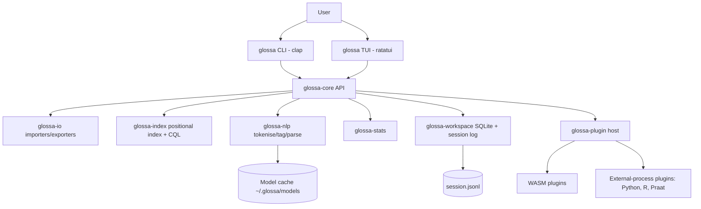

# Build plan / technical spec

## 1. Stack decision
| Concern | Choice | Rationale |
|---|---|---|
| Language | **Rust (stable, 2021 edition)** | Single static binary, no runtime, memory-safe, fast enough for 100M-token indexes, great Unicode crates |
| TUI | **ratatui + crossterm** | Most active Rust TUI ecosystem; crossterm works on Windows natively |
| CLI | **clap (derive)** | Subcommands, completions, man pages |
| Index | Custom columnar positional index on **memmap2** + **fst** for vocabularies | KWIC/CQL needs token-position lookups; full-text engines (tantivy) are document-oriented. Assumption: custom is worth it; tantivy kept as fallback for metadata search |
| Metadata/log store | **SQLite (rusqlite, bundled)** | Workspaces, saved queries, metadata filters |
| Unicode | `unicode-segmentation`, `unicode-normalization`, `unicode-width`, `icu_segmenter` | Grapheme/word/sentence boundaries across scripts |
| Neural models | **ort** (ONNX Runtime) behind a feature flag; pure-Rust rule tokeniser default | Run exported UD taggers/parsers without Python |
| Plugins | **Wasmtime (WASI components)** + JSON-RPC external-process plugins | Sandboxed portable plugins + escape hatch for Python/R tools |
| Formats | `quick-xml` (TEI/EAF), `zip` (DOCX), `pdf-extract`/`lopdf` (PDF text), custom CoNLL-U/CHAT parsers | |
| Stats | `statrs` in-process; R/Python bridge later | |
| Output | `serde_json`, `csv`, `arrow`/`parquet` (feature flag) | |

## 2. Architecture


## 3. Repository/module layout
```
glossa/
  Cargo.toml              # workspace
  crates/
    glossa-cli/           # binary: clap commands, launches TUI
    glossa-tui/           # ratatui app, screens, keymap, themes
    glossa-core/          # Request/Result types, provenance, orchestration
    glossa-io/            # importers + exporters per format
    glossa-index/         # columnar index, fst lexicons, CQL parser/executor
    glossa-nlp/           # tokeniser, ONNX tagger/parser, CoNLL-U model
    glossa-stats/         # association measures, keyness, dispersion
    glossa-workspace/     # project, saved queries, session log, methods/BibTeX
    glossa-plugin/        # plugin host + WIT interfaces
  plugins/examples/
  tests/gold/             # gold datasets + expected outputs
  docs/
```

## 4. Data and model handling
- **Corpus import:** source → normalised document stream (text, metadata, optional pre-existing annotation) → annotation (optional) → index segments.
- **Index:** per attribute (word, lower, lemma, upos, feats) a vocabulary FST mapping string → id, plus a `u32` id column per token; inverted postings (id → positions, delta + varint compressed); sentence/document boundary bitmaps; metadata in SQLite. Segments are immutable and merge on demand. Corpus hash = SHA-256 over segment hashes.
- **CQL execution:** parse to AST → choose rarest token constraint → scan its postings → verify neighbours against columns.
- **Models:** `glossa models list|pull|rm|info`. Manifest (TOML, signed checksums) lists URL, SHA-256, licence, citation. Stored in `~/.glossa/models/<name>/<version>/`. Licence displayed and requires `--accept-license` for non-permissive licences. Every result records the model SHA-256.
- **Default pipeline (MVP):** rule-based tokeniser/sentence splitter (Unicode UAX #29 + per-language abbreviation lists) built in; neural tagger/lemmatiser/parser via ONNX models converted from permissively licensed UD-trained models (assumption: export path from Stanza/Trankit-style models to ONNX is viable; fallback is the `stanza` external-process plugin).

## 5. Plugin API (v0)
- **WASM component** implementing WIT world `glossa:plugin/tool`:
  - `describe() -> manifest` (name, version, commands, input/output schemas)
  - `run(command, params-json, input-stream) -> output-stream`
- **External process:** any executable speaking newline-delimited JSON-RPC over stdio (`describe`, `run`). Used for Python (spaCy/Stanza), R, Praat.
- Capability-based: plugins get no filesystem/network unless the manifest asks and the user grants.
- Plugin outputs are wrapped in the same provenance record as built-ins.

## 6. CLI command tree
```
glossa                       # open TUI
glossa init [dir]            # create workspace
glossa corpus add <path> [--meta meta.csv] [--annotate --lang xx]
glossa corpus ls|info|rm|sub <name> --where 'year>=2000'
glossa kwic <query> [-c corpus] [--cql|--regex] [--sort R1,L1] [--context 8]
glossa freq [--attr lemma] [--ngram 1..5] [--min 3]
glossa colloc <node> [--window 5 --measure logdice,mi,t,ll]
glossa keyness --target A --ref B [--measure ll,logratio]
glossa disp <query> [--measure dp,juilland,range]
glossa compare <subA> <subB>
glossa tokenize|tag|parse [--lang xx] [--model name] < text
glossa tree <conllu> [--sent N]
glossa tq <pattern> <conllu|corpus>          # treebank query
glossa morph <word|file> --analyser <plugin>
glossa export <result-id|query> --to csv|json|conllu|tei|eaf|parquet
glossa query save|ls|run <name>
glossa log show|replay|methods|bib
glossa models list|pull|rm|info
glossa plugin add|ls|rm|run
glossa config get|set
```
Global flags: `--json`, `--plain`, `--no-color`, `--seed`, `--workspace`.

## 7. TUI screen map
```
Home (projects, recent)
 ├─ Corpus browser ── document view ── metadata
 ├─ Concordance (KWIC) ── sentence ── dependency tree
 ├─ Frequency / n-grams ── KWIC for item
 ├─ Collocations ── KWIC for pair
 ├─ Keyness ── KWIC in target/ref
 ├─ Dispersion plot
 ├─ Subcorpus compare
 ├─ Parse / tree viewer ── treebank query
 ├─ Saved queries
 ├─ Session log ── methods / BibTeX preview
 ├─ Models & plugins
 └─ Settings (themes, keymap, accessibility)
```

## 8. Testing strategy
- **Unit + property tests** (`proptest`): tokeniser invariants, index round-trips, CQL parser.
- **Golden-file tests** (`insta`): every CLI command's JSON output on fixture corpora.
- **Statistical correctness:** association measures checked against hand-computed values from the formulas in Evert (2005) and against AntConc/published examples; 4-decimal tolerance.
- **Accuracy benchmarks:** UD test sets (e.g. UD English EWT, German GSD, Finnish TDT, Turkish IMST) scored with the official CoNLL 2018 shared-task evaluation script; report UPOS, Lemma, UAS, LAS; CI fails on > 1 point regression.
- **Performance benchmarks** (`criterion`): indexing tokens/s; KWIC latency on a 100M-token synthetic corpus.
- **TUI tests:** ratatui `TestBackend` snapshot tests per screen; keyboard-only scripted walks.
- **Accessibility:** `--plain` output tested with Orca (Linux) and NVDA (Windows) checklists each release.
- **Cross-platform CI:** GitHub Actions matrix (ubuntu, macos, windows).

## 9. Packaging and distribution
- `cargo-dist` builds release artefacts + shell/PowerShell installers: `curl -LsSf https://glossa.tools/install.sh | sh` (domain assumption) and `irm …/install.ps1 | iex`.
- Homebrew tap, Scoop bucket, `cargo install glossa-cli` (crate name `glossa` is taken), AUR, Nix flake later.
- Signed checksums; reproducible builds where feasible.

## 10. Licensing
- **Code:** MIT.
- **Bundled data:** only permissive items (abbreviation lists, UD tag sets, small sample corpus in public domain e.g. Project Gutenberg texts).
- **Not bundled, download on demand with licence recorded:** UD treebanks (licences vary per treebank, many CC BY-SA, some CC BY-NC-SA), UDPipe models (CC BY-NC-SA), WordNet (Princeton WordNet licence), WALS (CC BY 4.0), Glottolog (CC BY 4.0), PHOIBLE (CC BY-SA 3.0), SUBTLEX norms (check per dataset), Wiktionary (CC BY-SA). The manifest stores each licence; `glossa log bib` cites them.

## 11. Staged milestones
| Stage | Scope | Weeks | Done when |
|---|---|---|---|
| **0 Foundations** | Cargo workspace, clap skeleton, `--json` envelope with provenance, workspace init, session log, CI matrix, cargo-dist | 1 | `glossa init && glossa --version --json` works on all 3 OS in CI; log records the call |
| **1 Import + index + KWIC** | TXT/HTML/DOCX/PDF/CoNLL-U importers, tokeniser, positional index, plain/regex KWIC, sort | 1–2 | 10M-token corpus indexes in < 30 s and `glossa kwic` returns in < 1 s; golden tests pass |
| **2 Stats core** | Frequency, n-grams, collocations (5 measures), keyness, dispersion, subcorpora | 3 | All measures match hand-computed fixtures to 4 dp |
| **3 Annotation + CQL** | ONNX tagger/lemmatiser/parser, models pull, CQL subset, TEI/CHAT/EAF import | 4 | `glossa parse` LAS within 2 points of the source model on EWT; CQL test suite (≥ 50 queries) passes |
| **4 TUI MVP** | Screens: home, corpus, KWIC, freq, colloc, keyness, tree, log; themes; `--plain` | 5 | A new user completes import → KWIC → collocates → export with keyboard only in < 5 min |
| **5 Workflow + plugins v0** | Saved queries, replay, methods/BibTeX, exports, WASM + process plugins, treebank query | 6 | `glossa log replay` reproduces byte-identical outputs; an example Python plugin runs; **MVP release v0.1** |
| 6 | Module 5 Stats/vis | +3 | Chi-square/Fisher match R to 6 dp; `lme4` model runs via bridge; SVG export renders |
| 7 | Module 3 Phonetics | +4 | TextGrid round-trips; formant/pitch via Praat bridge match Praat output; G2P on 3 languages |
| 8 | Module 4 Fieldwork | +4 | IGT aligns morpheme-gloss per Leipzig rules; EAF/LIFT round-trip; kappa matches reference |
| 9 | Module 6 Lexicography | +3 | Word sketch for 10 test lemmas matches expected grammatical relations; WordNet lookup offline |
| 10 | Module 8 Typology | +3 | Language ID ≥ 95% accuracy on a held-out set; WALS/Glottolog/PHOIBLE queries offline |
| 11 | Module 7 Historical | +4 | Sound-change simulator reproduces textbook derivations (e.g. Grimm's law set); cognate detection scored against a published benchmark |
| 12 | Module 9 Socioling | +3 | Variation tables by metadata match manual counts; stylometry (Burrows' Delta) matches reference implementation |
| 13 | Module 10 Psycholing | +2 | Stimulus builder returns matched lists within stated tolerances; norms lookup offline |
| 14 | v1.0 | +2 | Plugin API frozen, docs complete, installers on all channels |
